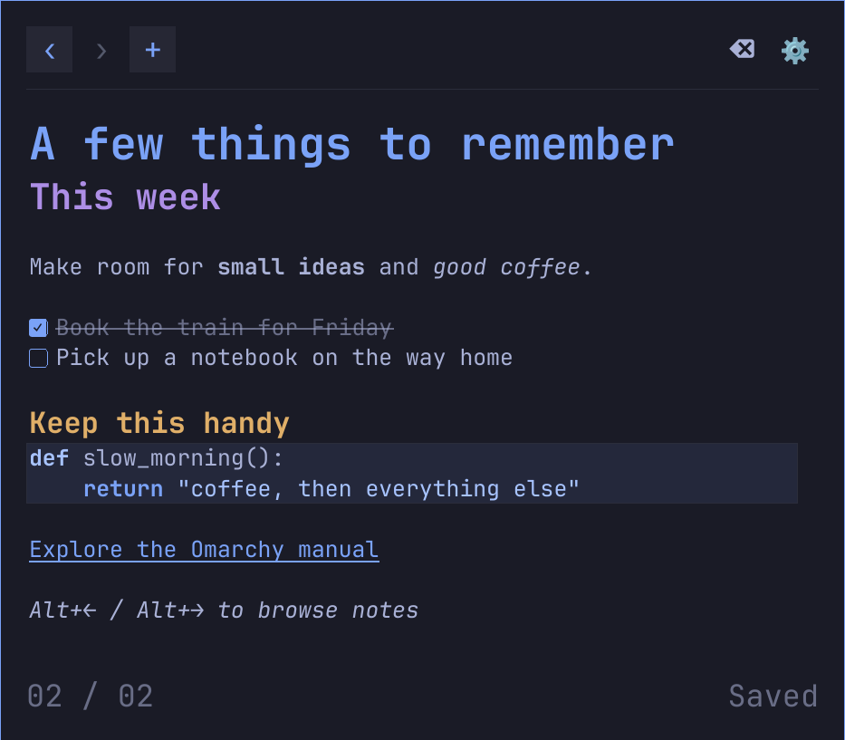

# traymd-omarchy

Quick Markdown notes for Omarchy. Open a small popup, jot something down and
get back to what you were doing. Notes save automatically, Markdown renders as
you type, and colours follow your theme.



## Installation

For the Quickshell-based Omarchy desktop:

```bash
omarchy plugin add https://github.com/rabfulton/traymd-omarchy.git --enable
```

Choose **left**, **center** or **right** when Omarchy asks where to put the icon.
Setup starts automatically in a terminal. It installs any missing build
packages, builds the editor and restarts the shell. Your chosen position is kept.

## Usage

Click the notes icon to open or close the popup. It stays above normal windows
until dismissed with Escape, Ctrl+W or the bar icon. Type normally: headings,
emphasis, lists and code render in place. **Ctrl+click** a link to open it in
your default browser. Ordinary clicks and dragging let you edit and select text.

Opening the popup focuses the note so you can type immediately, wherever the
mouse is. Clicking another window releases focus and leaves the note visible.

Use **+** or **Ctrl+N** to create a note, and **‹** / **›** or
**Alt+Left** / **Alt+Right** to move between notes. The right-click menu
includes undo, redo, cut, copy, paste and select all.

Edits save after 1.5 seconds of idle time, and when switching or closing notes.
Markdown files added to the notes folder appear automatically. External changes
to saved notes also appear without restarting the app.

### Typing Markdown

Type the examples below directly into a note. The editor formats the text as
you type and hides most Markdown markers; the saved file keeps the original
Markdown. Complete both the opening and closing markers for inline formatting.

| Feature | What to type |
| --- | --- |
| Heading | Start a line with `# Heading`, `## Subheading` or `### Smaller heading`. Use up to six `#` characters, followed by a space. |
| Bold | `**bold text**` or `__bold text__` |
| Italic | `*italic text*` or `_italic text_` |
| Bold and italic | `***bold and italic***` |
| Strikethrough | `~~crossed-out text~~` |
| Inline code | Surround text with one backtick on each side: `` `code here` ``. |
| Bullet list | Start each item on a new line with `- Item` or `* Item`. Include the space after the marker. |
| Numbered list | Start a line with `1. First item`. Enter adds the next number. |
| Unchecked task | `- [ ] To do` — include a space inside the brackets and after them. |
| Completed task | `- [x] Done` |
| Quote | Start a line with `> Quoted text`. Repeat `> ` on each quoted line. |
| Named link | `[Example website](https://example.com)` |
| Automatic link | Type `https://example.com` or `www.example.com`. |
| Horizontal divider | Type `---` or `***` on its own line, press Enter, then move the cursor off that line to show the divider. |

Press **Enter** after a list item to continue the list. Press **Enter** again
on an empty item to leave the list. For tasks, Enter creates an unchecked item,
even if the previous task is complete. Click a checkbox to toggle it; completed
tasks appear crossed out. **Ctrl+click** a named or automatic link to open it.

For a code block, type three backticks on a line, the code on the following
lines, and three backticks on a closing line. An optional language name after
the opening backticks enables syntax highlighting for supported languages,
such as `python` or `c`:

````markdown
```python
def remember():
    return "A quick note"
```
````

You can also use three tildes (`~~~`) for both fences. Fence lines become
hidden when the cursor moves away from them. Markdown markers inside a code
block or inline code are treated as literal text.

To turn a heading, quote or task back into plain text, place the cursor at the
start of its visible text and press **Backspace** to remove the prefix.

## Shortcuts

Defaults while the popup is focused:

| Shortcut | Action |
| --- | --- |
| Alt+Left / Alt+Right | Older / newer note |
| Ctrl+N | New note |
| Escape or Ctrl+W | Close |
| Ctrl+, | Settings |
| Ctrl+S | Save immediately |
| Ctrl+Shift+Delete | Delete, after confirmation |

Alt+Left/Right switches notes; Ctrl+Left/Right keeps normal word navigation.

Edit `~/.config/traymd-omarchy/config.ini` to change these bindings. The file
is created automatically on first use, and changes apply without a restart.
For example:

```ini
[shortcuts]
older_note=Ctrl+Shift+H
newer_note=Ctrl+Shift+L
```

Other keys are `new_note`, `close`, `settings`, `save` and `delete_note`.
An empty value disables a binding. Escape always remains available to cancel
or close. Invalid or duplicate bindings leave the last working settings active.

For a **global** show/hide shortcut, use **Settings → Shortcut → Set**, then
press a Super key combination. Existing shortcuts are checked before saving.

## Files

| Location | Contents |
| --- | --- |
| `~/.local/share/traymd/notes/` | Markdown notes, compatible with XFCE TrayMD |
| `~/.local/share/traymd/notes/.trash/` | Recoverable deleted notes |
| `~/.config/traymd-omarchy/config.ini` | In-app shortcuts |
| `~/.config/traymd-omarchy/notes.ini` | Last selected note |
| `~/.config/omarchy/shell.json` | Popup size and placement, in the plugin's bar entry |
| `~/.config/hypr/bindings.lua` | Global shortcut, in a marked TrayMD block |

Custom `XDG_CONFIG_HOME` and `XDG_DATA_HOME` locations are respected for the
app config and notes. A custom notes folder can be set in Omarchy's bar settings.

The notes folder (including a custom folder) and `.trash` are restricted to your
account (`0700`). New and saved notes use owner-only permissions (`0600`).
Opening an existing notes folder tightens its permissions, protecting the notes
and trash inside; existing files get `0600` when next saved.

## Appearance

On first use, the popup is square, with each side half the monitor height,
adjusted to fit small screens.
Fonts follow Omarchy's theme and display scaling. Use the gear button to
change the size or choose between the screen centre and the bar icon.

## Updating and removal

```bash
omarchy plugin update traymd-omarchy
```

The update builds the editor if needed and restarts the shell before returning.
Regular `omarchy update` also prepares the editor after Qt upgrades, using
Omarchy's final shell restart. There is no separate icon click or setup terminal.

Upgrading from an older build and still seeing the old editor? Rebuild once:

```bash
bash ~/.config/omarchy/plugins/traymd-omarchy/install.sh
```

This also installs the update hooks and restarts the shell. Future updates use
the single operation above.

Already installed from a development checkout? From that checkout, run:

```bash
python3 scripts/switch-to-release.py
```

This backs up settings, replaces the copied plugin with a GitHub checkout and
uses Omarchy's normal placement prompt. Notes and app configuration are kept.
For development installs, `./install.sh` is still available.
Remove with `omarchy plugin remove traymd-omarchy`; your notes are kept.

## Development and license

See [development notes](docs/DEVELOPMENT.md) for building and tests.
[MIT licensed](LICENSE).
